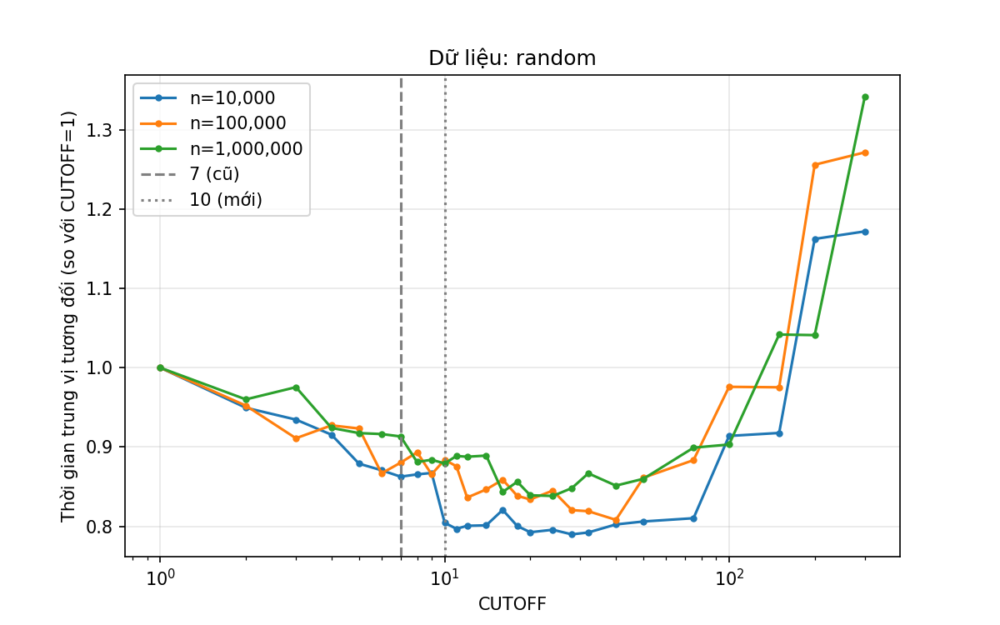
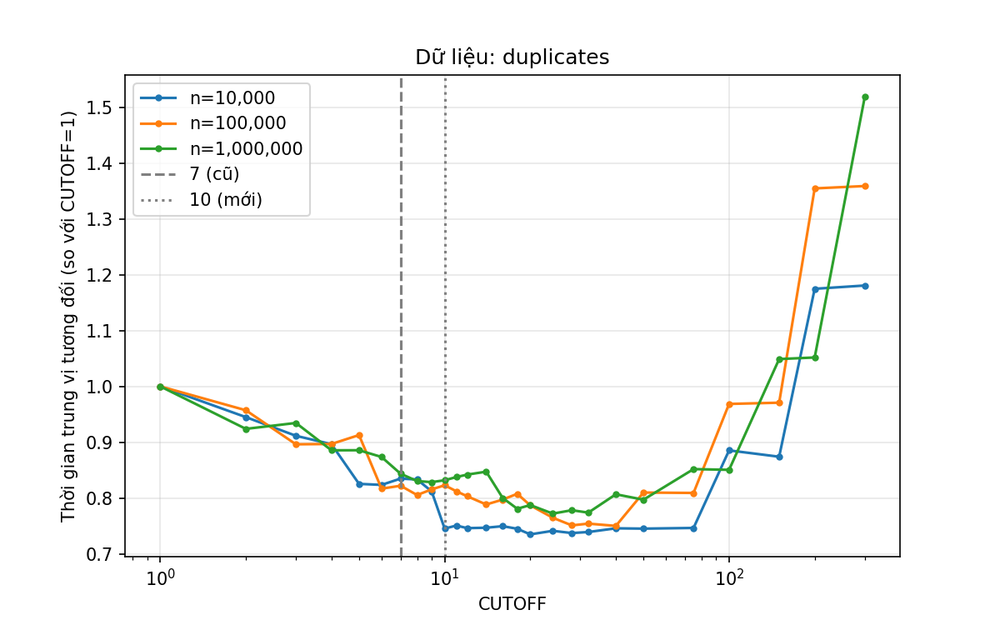
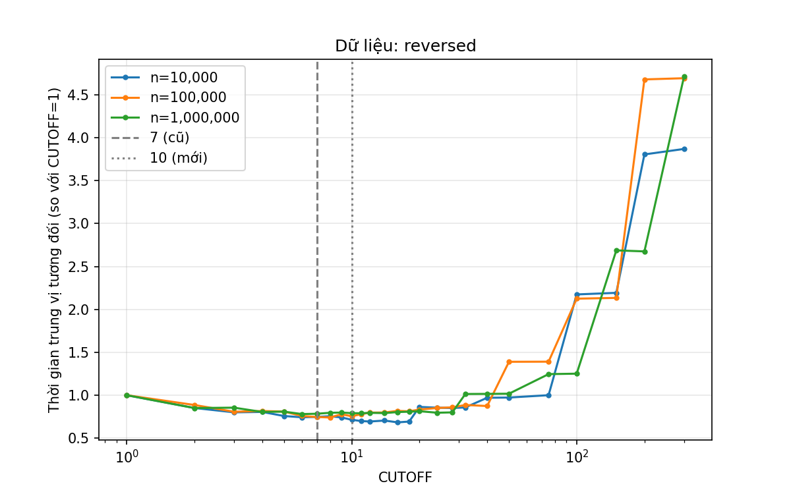
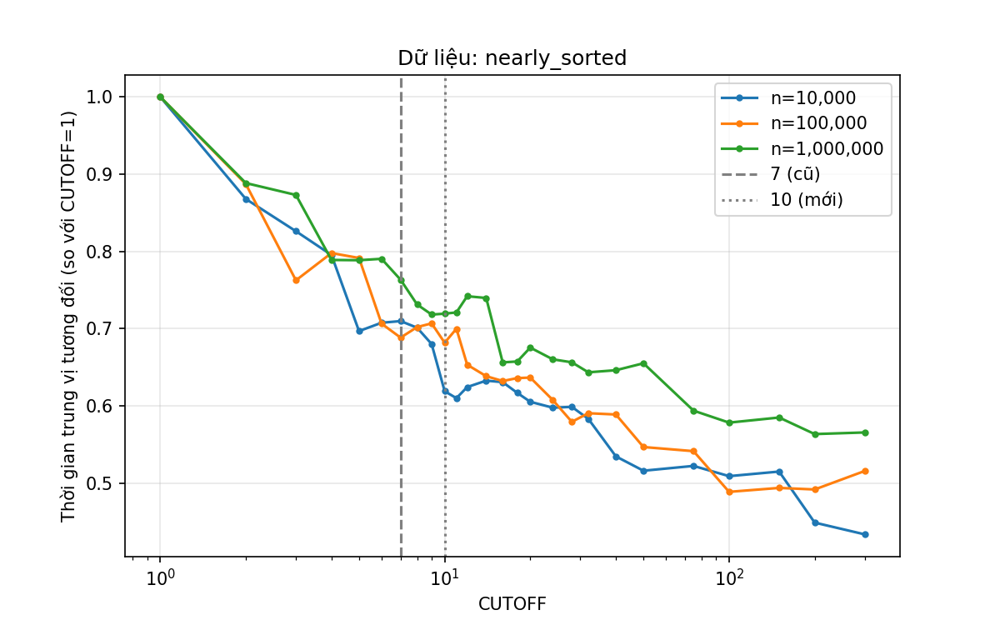

# Báo cáo thí nghiệm: tìm giá trị CUTOFF tốt nhất cho Mergesort

- **Sinh viên:** [Nguyễn Thị Tuệ Anh] – MSSV: [25023162]
- **Môn học / bài tập:** [Tên môn] – Chủ đề: Mergesort và cải tiến CUTOFF
- **Ngày thực hiện:** [20/11/2026]

## 1. Mục tiêu và giả thuyết

Giáo trình nhắc đến cải tiến: khi mảng con có độ dài nhỏ thì chuyển từ đệ quy Mergesort sang Insertion sort. Phiên bản cũ dùng CUTOFF = 7, phiên bản mới dùng CUTOFF = 10. Báo cáo này đo thực nghiệm để tìm CUTOFF tốt nhất trên máy của tôi, với Mergesort do tôi tự cài đặt theo bài giảng.

Giả thuyết:

- CUTOFF nhỏ (về 1): có nhiều lời gọi đệ quy và nhiều lần `merge` trên mảng rất bé, overhead lớn, nên chậm.
- CUTOFF lớn: Insertion sort có chi phí O(k²) trên mỗi đoạn dài k, nên chi phí tăng dần, tới một mức nào đó sẽ chậm hơn Mergesort.
- Do đó đường cong thời gian theo CUTOFF có dạng chữ U nông, với đáy ở một vùng giá trị chứ không hẳn ở một điểm.

## 2. Môi trường thí nghiệm

Thành phần
Thông tin
Máy
Laptop (LAPTOP-DIEJTBL0)
CPU
11th Gen Intel Core i5-1135G7 @ 2.40 GHz
RAM
8 GB (7,77 GB khả dụng)
Hệ điều hành
Windows, 64-bit
Ngôn ngữ
Java, JDK 25
IDE
IntelliJ IDEA
Tham số JVM
-Xms2g -Xmx2g (heap cố định, tránh nhiễu do thay đổi kích thước heap)
Đo thời gian
System.nanoTime()
Phân tích
Python (pandas, scipy, matplotlib)
Khi chạy lần cuối, máy được cắm sạc và đóng các ứng dụng khác.

## 3. Cài đặt

Mã nguồn: `src/MergeSort.java`. Đây là Mergesort top-down theo bài giảng:

- Mảng phụ `aux` được cấp phát **một lần** trong `sort(int[] a, int cutoff)`, không cấp phát trong đệ quy.
- **Quy ước CUTOFF:** nếu độ dài đoạn `hi - lo + 1 <= cutoff` thì gọi Insertion sort. Như vậy CUTOFF = 1 nghĩa là Mergesort thuần (chỉ dừng khi còn 1 phần tử), CUTOFF = 7 nghĩa là đoạn dài tối đa 7 phần tử dùng Insertion sort.
- `merge` chép đoạn `a[lo..hi]` sang `aux` rồi trộn ngược về `a`; khi hai phần tử bằng nhau thì lấy từ nửa trái (sắp ổn định).
- Insertion sort cài bằng các phép **đổi chỗ liền kề** (`a[j]` với `a[j-1]`), đúng như cách viết trong bài giảng.
- **Không** bật các cải tiến khác (không kiểm tra `a[mid] <= a[mid+1]` để bỏ qua merge, không đảo vai trò `a`/`aux`). Nhờ vậy CUTOFF là biến duy nhất thay đổi giữa các lần đo. Hệ quả cho dữ liệu gần sắp xếp được bàn ở mục 6.3.

**Kiểm tra tính đúng:** `src/Test.java` so sánh kết quả với `Arrays.sort` trên CUTOFF ∈ {1, 2, 7, 10, 50, 100000}, kích thước ∈ {0, 1, 2, 3, 10, 11, 100, 1000, 12345}, mỗi cấu hình 50 lần, gồm dữ liệu ngẫu nhiên và dữ liệu có rất nhiều giá trị trùng. Kết quả: "Tất cả test đều đúng." Việc kiểm tra này chạy riêng, nằm ngoài vùng đo thời gian.

## 4. Phương pháp thí nghiệm

| Yếu tố | Thiết lập |
|---|---|
| Giá trị CUTOFF (26 giá trị) | 1–12 (từng giá trị), 14, 16, 18, 20, 24, 28, 32, 40, 50, 75, 100, 150, 200, 300 |
| Kích thước n | 10 000; 100 000; 1 000 000 |
| Loại dữ liệu | `random` (ngẫu nhiên `int`), `nearly_sorted` (dãy 0..n-1 rồi hoán vị ngẫu nhiên n/100 cặp), `reversed` (n, n-1, ..., 1), `duplicates` (giá trị trong 0..99) |
| Số lượt đo (trial) | 30 cho mỗi (loại, n, CUTOFF) |
| Warm-up | 10 vòng cho mỗi (loại, n), chạy mọi CUTOFF trên dữ liệu seed khác (999+w), kết quả bỏ đi |
| Dữ liệu | Seed = chỉ số lượt đo `t`. Trong cùng lượt `t`, **mọi CUTOFF sắp xếp cùng một mảng** (bản sao `clone()`) nên so sánh công bằng |
| Thứ tự chạy | Xáo trộn ngẫu nhiên thứ tự các CUTOFF trong mỗi lượt (seed = t) để tránh sai lệch do nhiệt độ CPU hoặc tiến trình nền |
| Đo | `System.nanoTime()` quanh đúng lời gọi `MergeSort.sort`; việc sinh dữ liệu và `clone()` nằm ngoài vùng đo |
| Tổng số phép đo | 4 loại × 3 cỡ × 30 lượt × 26 CUTOFF = 9 360 |

Thống kê (`scripts/analyze.py`):

- Với mỗi (loại, n, CUTOFF): trung bình, **trung vị**, độ lệch chuẩn, khoảng tin cậy 95% xấp xỉ `1.96·std/√30`.
- Dùng **trung vị** làm chỉ số chính vì ít bị ảnh hưởng bởi các lượt đo bị nhiễu (GC, tiến trình nền).
- "Vùng tốt" là tập CUTOFF có trung vị không quá 5% so với giá trị tốt nhất.
- So sánh CUTOFF 7 với 10 bằng kiểm định Wilcoxon ghép cặp theo lượt đo (vì hai giá trị cùng sắp xếp một mảng ở mỗi lượt).

## 5. Kết quả

Số liệu đầy đủ: `data/results.csv` (thô), `data/summary.csv` (bảng thống kê).

### 5.1. CUTOFF tối ưu theo trung vị

Thời gian trung vị ở mức tốt nhất, và mức tăng tốc so với CUTOFF = 1 (Mergesort thuần).

| Loại dữ liệu | n | CUTOFF tốt nhất | Thời gian tốt nhất (ms) | Tăng tốc so với CUTOFF=1 | Vùng tốt (≤ +5%) |
|---|---:|---:|---:|---:|---|
| random | 10 000 | 28 | 0,631 | 1,27× | 10 – 75 |
| random | 100 000 | 40 | 7,310 | 1,24× | 12 – 40 |
| random | 1 000 000 | 24 | 91,507 | 1,19× | 10 – 50 |
| duplicates | 10 000 | 20 | 0,450 | 1,36× | 10 – 75 |
| duplicates | 100 000 | 40 | 4,949 | 1,33× | 20 – 40 |
| duplicates | 1 000 000 | 24 | 56,384 | 1,30× | 16 – 50 |
| reversed | 10 000 | 16 | 0,176 | 1,46× | 10 – 18 |
| reversed | 100 000 | 8 | 2,086 | 1,35× | 6 – 10 |
| reversed | 1 000 000 | 6 | 26,667 | 1,28× | 4 – 28 |
| nearly_sorted | 10 000 | 300 | 0,142 | 2,31× | 200 – 300 |
| nearly_sorted | 100 000 | 100 | 1,605 | 2,05× | 100 – 200 |
| nearly_sorted | 1 000 000 | 200 | 21,500 | 1,78× | 100 – 300 |

### 5.2. Đồ thị

Thời gian trung vị tương đối so với CUTOFF = 1 (trục hoành log). Đường nét đứt: CUTOFF = 7, nét chấm: CUTOFF = 10.

| | |
|---|---|
|  |  |
|  |  |

### 5.3. So sánh CUTOFF = 7 và 10 của giáo trình

`diff_pct` > 0 nghĩa là CUTOFF = 7 chậm hơn CUTOFF = 10. Có ý nghĩa thống kê khi p < 0,05.

| Loại | n | Trung vị CUTOFF=7 (ms) | Trung vị CUTOFF=10 (ms) | diff_pct | p (Wilcoxon) | Kết luận |
|---|---:|---:|---:|---:|---:|---|
| random | 10 000 | 0,689 | 0,643 | 7,31 | 0,0019 | 10 nhanh hơn |
| random | 100 000 | 7,962 | 7,996 | −0,20 | 0,7766 | không khác biệt |
| random | 1 000 000 | 99,700 | 95,985 | 2,93 | 0,0006 | 10 nhanh hơn |
| duplicates | 10 000 | 0,511 | 0,457 | 11,14 | 0,0001 | 10 nhanh hơn |
| duplicates | 100 000 | 5,424 | 5,429 | −0,11 | 0,8394 | không khác biệt |
| duplicates | 1 000 000 | 61,600 | 60,746 | 2,47 | 0,1840 | không khác biệt |
| reversed | 10 000 | 0,192 | 0,183 | 7,61 | 0,0449 | 10 nhanh hơn (sát ngưỡng) |
| reversed | 100 000 | 2,102 | 2,126 | −1,25 | 0,2801 | không khác biệt |
| reversed | 1 000 000 | 26,788 | 27,030 | −0,51 | 0,3285 | không khác biệt |
| nearly_sorted | 10 000 | 0,233 | 0,203 | 15,46 | < 0,0001 | 10 nhanh hơn |
| nearly_sorted | 100 000 | 2,262 | 2,240 | 0,87 | 0,5786 | không khác biệt |
| nearly_sorted | 1 000 000 | 29,128 | 27,450 | 5,95 | 0,0028 | 10 nhanh hơn |

### 5.4. Chi phí so với mức tốt nhất của một số CUTOFF ứng viên

Mỗi ô là (trung vị tại CUTOFF đó) / (trung vị tốt nhất). Giá trị 1,00 là tối ưu.

| Loại | n | 7 | 10 | 16 | 20 | 24 | 32 |
|---|---:|---:|---:|---:|---:|---:|---:|
| random | 10 000 | 1,09 | 1,02 | 1,04 | 1,00 | 1,01 | 1,00 |
| random | 100 000 | 1,09 | 1,09 | 1,06 | 1,03 | 1,05 | 1,01 |
| random | 1 000 000 | 1,09 | 1,05 | 1,01 | 1,00 | 1,00 | 1,03 |
| duplicates | 10 000 | 1,14 | 1,01 | 1,02 | 1,00 | 1,01 | 1,01 |
| duplicates | 100 000 | 1,10 | 1,10 | 1,06 | 1,05 | 1,02 | 1,01 |
| duplicates | 1 000 000 | 1,09 | 1,08 | 1,04 | 1,02 | 1,00 | 1,00 |
| reversed | 10 000 | 1,09 | 1,04 | 1,00 | 1,26 | 1,25 | 1,26 |
| reversed | 100 000 | 1,01 | 1,02 | 1,10 | 1,13 | 1,15 | 1,20 |
| reversed | 1 000 000 | 1,01 | 1,01 | 1,03 | 1,04 | 1,02 | 1,30 |
| nearly_sorted | 10 000 | 1,64 | 1,43 | 1,46 | 1,40 | 1,38 | 1,35 |
| nearly_sorted | 100 000 | 1,41 | 1,40 | 1,29 | 1,30 | 1,24 | 1,21 |
| nearly_sorted | 1 000 000 | 1,36 | 1,28 | 1,17 | 1,20 | 1,17 | 1,14 |

## 6. Phân tích

### 6.1. Hình dạng đường cong

Dữ liệu ủng hộ giả thuyết. Ở mọi loại dữ liệu, thời gian giảm rõ khi tăng CUTOFF từ 1 lên khoảng 8–10, rồi đi gần phẳng ở một vùng đáy, sau đó tăng. Tăng tốc so với Mergesort thuần là 1,19–1,27× với dữ liệu ngẫu nhiên, 1,30–1,36× với dữ liệu trùng nhiều, 1,28–1,46× với dữ liệu sắp giảm. Với dữ liệu ngẫu nhiên, ở CUTOFF = 300 thời gian tệ hơn CUTOFF = 1 (ví dụ n = 10⁶: 146 ms so với 109 ms), do chi phí O(k²) của Insertion sort.

### 6.2. Dữ liệu ngẫu nhiên và dữ liệu nhiều giá trị trùng

Đây là hai trường hợp điển hình. CUTOFF tốt nhất rơi vào 20–40 (24 ở n = 10⁶). Đáy khá phẳng: các CUTOFF từ khoảng 20 đến 40 chỉ chênh nhau 1–3%, trong khi độ lệch chuẩn tương đối của các lượt đo ở đáy là 5–15%. Với độ nhiễu cỡ đó, **không thể khẳng định một giá trị duy nhất là tốt nhất**; kết luận trung thực là vùng tối ưu nằm trong khoảng **khoảng 16–40**.

So với giáo trình: CUTOFF = 7 chậm hơn đáy khoảng 9–14% và CUTOFF = 10 chậm hơn 2–10%. Nghĩa là cả hai giá trị trong sách đều nằm ở sườn xuống của đường cong, chưa tới đáy, nhưng mức thua thiệt không lớn.

### 6.3. Dữ liệu sắp giảm (reversed)

Kết quả khác hẳn: đáy nằm ở giá trị nhỏ (6–16) và vùng tốt hẹp ở n = 10⁵ (6–10). Lý do là dữ liệu sắp giảm là trường hợp xấu nhất của Insertion sort (mỗi phần tử phải dịch hết về đầu đoạn), nên chi phí O(k²) tăng nhanh theo CUTOFF. Ở CUTOFF = 300 với n = 10⁶, thời gian là 161 ms so với 26,7 ms ở đáy, chậm hơn khoảng 6 lần. Với loại dữ liệu này, CUTOFF = 7 và 10 gần như tối ưu (chênh dưới 2% ở n = 10⁵ và 10⁶).

### 6.4. Dữ liệu gần sắp xếp (nearly_sorted)

Đáy nằm ở **200–300, tức sát biên trên của lưới CUTOFF đã thử**, nên với loại này tôi không thể khẳng định đã tìm thấy đáy thực sự (đáy có thể còn nằm xa hơn). Nguyên nhân: Insertion sort chạy gần tuyến tính trên dữ liệu gần có thứ tự, trong khi cài đặt Mergesort của tôi không có bước kiểm tra `a[mid] <= a[mid+1]` nên vẫn phải trộn đầy đủ ở mọi mức. Do đó Insertion sort lấn dần phần việc của Mergesort và CUTOFF lớn có lợi, tăng tốc 1,8–2,3×. Kết quả này **gắn với cài đặt không có cải tiến kiểm tra "đã có thứ tự"**; nếu bật cải tiến đó thì Mergesort tự nó đã nhanh trên loại dữ liệu này và đáy có thể khác. Dữ liệu này cũng nhiễu nhất (độ lệch chuẩn tương đối tại đáy 8–26%) vì thời gian rất ngắn.

### 6.5. Ảnh hưởng của kích thước n

Vị trí đáy không dịch chuyển có hệ thống theo n: dữ liệu ngẫu nhiên có đáy ở 28, 40, 24 khi n = 10⁴, 10⁵, 10⁶; dữ liệu trùng nhiều ở 20, 40, 24. Đây là dao động trong vùng phẳng chứ không phải xu hướng, vì giá trị CUTOFF lân cận chênh nhau rất ít (xem 5.1). Vùng tốt của các n chồng lên nhau rộng, nên **CUTOFF tối ưu gần như không phụ thuộc n**, điều hợp lý vì chi phí trên một đoạn nhỏ không phụ thuộc kích thước toàn mảng. Về mặt lý thuyết, tổng thời gian vẫn tăng theo n log n.

### 6.6. Kiểm định 7 so với 10

Trong 12 cấu hình, CUTOFF = 10 nhanh hơn 7 có ý nghĩa thống kê (p < 0,05) ở 6 cấu hình, và **không có cấu hình nào** mà 7 nhanh hơn 10 có ý nghĩa. Ở các cấu hình còn lại, hai giá trị không phân biệt được. Chênh lệch có ý nghĩa lớn nhất ở n = 10⁴ (7–15%), nhưng với n = 10⁶ chỉ khoảng 3% trên dữ liệu ngẫu nhiên. Vậy cải tiến từ 7 lên 10 của giáo trình có cơ sở, nhưng hiệu quả nhỏ.

## 7. Kết luận

1. Cải tiến CUTOFF có hiệu quả rõ: nhanh hơn Mergesort thuần khoảng 19–46% với ba loại dữ liệu ngẫu nhiên, trùng nhiều, sắp giảm, và tới 1,8–2,3× với dữ liệu gần sắp xếp (trong cài đặt này).
2. Trên máy của tôi, với dữ liệu ngẫu nhiên (trường hợp chính), **vùng CUTOFF tối ưu là khoảng 16–40**, giá trị đề xuất **CUTOFF ≈ 24**. Với n = 10⁶ giá trị 24 đạt đúng đáy, với n = 10⁴ và 10⁵ nó cách đáy dưới 5%.
3. Nếu cần một giá trị chung cho nhiều loại dữ liệu, các giá trị 20–24 chỉ chậm hơn đáy dưới 5% trên dữ liệu ngẫu nhiên và trùng nhiều, nhưng có thể chậm hơn đáy tới 15–26% trên dữ liệu sắp giảm ở n nhỏ. Giá trị **10** là lựa chọn an toàn hơn cho trường hợp xấu nhất (chậm hơn đáy tối đa khoảng 10% với ba loại đầu), còn dữ liệu gần sắp xếp thì cần CUTOFF lớn hơn nhiều.
4. Hai giá trị 7 và 10 của giáo trình đều không phải đáy trên máy này; 10 tốt hơn 7 một cách có ý nghĩa ở 6/12 cấu hình, chưa thấy trường hợp ngược lại.

## 8. Hạn chế

- Kết quả đặc thù cho một máy, một phiên bản JVM, và cài đặt Mergesort này (không có kiểm tra `a[mid] <= a[mid+1]`, Insertion sort dùng đổi chỗ). Cài đặt Insertion sort kiểu "dịch phần tử" (không đổi chỗ) sẽ làm Insertion sort rẻ hơn và có thể đẩy CUTOFF tối ưu lên cao hơn.
- Toàn bộ thí nghiệm chạy trong một tiến trình JVM; dù đã warm-up cho từng cấu hình, trạng thái JIT từ các cấu hình trước có thể ảnh hưởng nhẹ.
- Lưới CUTOFF thưa ở vùng lớn (75, 100, 150, 200, 300) và đáy của `nearly_sorted` chạm biên 300 nên chưa xác định được.
- Khoảng tin cậy dùng xấp xỉ chuẩn (hệ số 1,96) với 30 mẫu; đây là xấp xỉ, kiểm định Wilcoxon là bằng chứng chính cho so sánh cặp.
- Chỉ đo kiểu `int`; với đối tượng (so sánh qua `compareTo`) chi phí so sánh khác nên CUTOFF tối ưu có thể khác.
- Thời gian đo ở n = 10⁴ rất ngắn (0,1–0,9 ms) nên nhiễu tương đối lớn.

## 9. Cách chạy lại

Xem `README.md`.

## 10. Phụ lục

- Log hội thoại với AI: `ai_chat_log.md`.
- Mã nguồn: `src/MergeSort.java`, `src/Benchmark.java`, `src/Test.java`, `scripts/analyze.py`.
- Số liệu: `data/results.csv`, `data/summary.csv`, `data/best_cutoff.csv`, `data/compare_7_vs_10.csv`.
